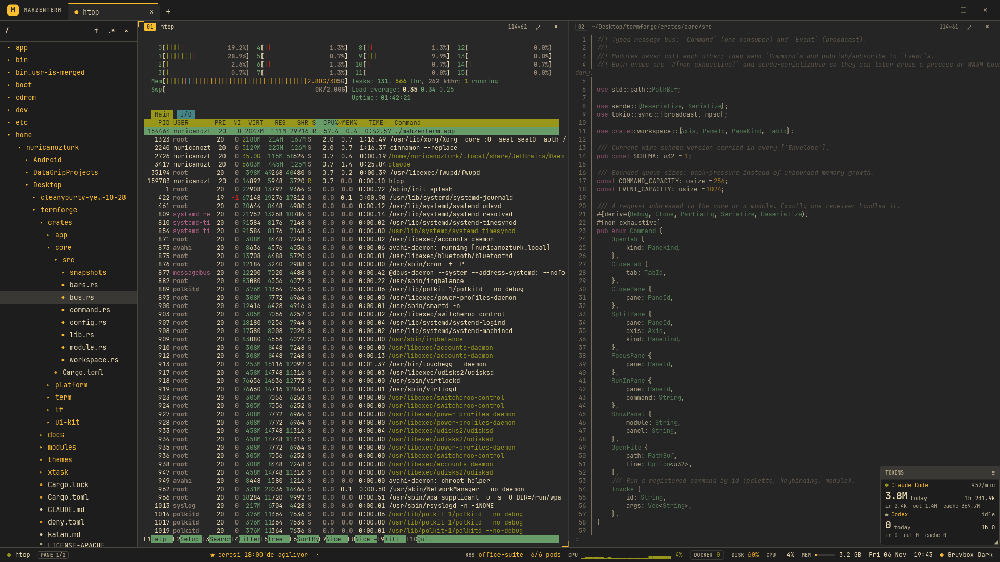

# MahzenTerm

*A terminal with depth.*

Fast, modular, native terminal and workspace (Linux, macOS, Windows), written in Rust.



*File explorer with git badges, two panes (`htop`, a code preview), the floating Claude Code / Codex token card at the
bottom right, and live status-bar widgets (Kubernetes namespace and pods, CPU sparkline, Docker, disk, a scrolling ticker).*

## What it does

- **Terminal:** tabs, splits, zoom, search (regex, whole word), clickable links, OSC 8/52/133/7, 11 themes, live config reload.
- **Images:** Kitty graphics, Sixel and iTerm2 inline images; `tf img photo.jpg` shows PNG, JPEG, GIF, WebP and more.
- **Workspace:** file explorer (git badges, fuzzy search, rename, trash), Markdown and code viewer (`tf cat`), editor hand-off
  (`Ctrl`+click `file:line`).
- **Store:** browse terminal apps (yazi, helix, btop, lazygit, k9s ...) and install them with a visible, confirmed command.
- **AI:** floating cards for Claude Code / Codex token use and live Claude Code sessions (click to jump to the pane).
- **Kubernetes:** context and namespace in the status bar, pod list, logs, shells; production contexts ask first.
- **Profiles:** named environments (env vars, theme) for new panes, selectable per project.
- **Your own widgets:** scrolling text, command output, clocks and more, all from `config.toml`.

## How it works

One core, many modules. `core` holds the command bus, config and workspace model (no UI). Each feature is a crate under
`modules/` that talks to the rest only through commands and events; `app` wires them into an [Iced](https://iced.rs) shell.
Terminal emulation uses `alacritty_terminal`; the default renderer is CPU-based (about 20 MB RAM, 0% CPU when idle).
Features, themes, keymaps and the store catalog are declarative files (TOML), not code.

## Quick start

```sh
cargo run --release -p mahzenterm-app      # the terminal
cargo build --release -p mahzenterm-tf     # the `tf` helper (cat, view, img)
```

Press `Ctrl+Shift+P` for the command palette: every action is there and every shortcut can be rebound.

| Keys | Action |
|---|---|
| `Ctrl+Shift+T` / `Ctrl+Shift+D` / `Ctrl+Shift+E` | New tab / split right / split down |
| `Ctrl+Alt+Arrows`, `Ctrl+Alt+1..9` | Move between panes |
| `Ctrl+B` | File explorer |
| `Ctrl+Alt+S` | App store |
| `Ctrl+Alt+K` | Kubernetes pods |
| `Ctrl+Alt+U` / `Ctrl+Alt+A` | Token card / AI sessions card |

All shortcuts: [docs/keybindings.md](docs/keybindings.md).

## Configure

Your settings live in `~/.config/mahzenterm/config.toml` (`%APPDATA%\mahzenterm` on Windows, `~/Library/Application Support/mahzenterm`
on macOS). Changes apply as you save. A project can add `.mahzenterm/config.toml`.

```toml
[statusbar]
right = ["kube", "profile", "cpu", "memory", "clock", "theme"]

[widgets.news]
kind = "text"
text = "Deploy window opens at 18:00  ·  "
marquee = true
```

Docs: [widgets](docs/widgets.md) · [graphics](docs/graphics.md) · [shell integration](docs/shell-integration.md) ·
modules in [docs/modules](docs/modules) · status in [docs/STATUS.md](docs/STATUS.md).

## Project

- Product and architecture: [PLAN.md](PLAN.md)
- Contributor rules: [CLAUDE.md](CLAUDE.md)

Quality gate:

```sh
cargo fmt --all --check
cargo clippy --all-targets --all-features -- -D warnings
cargo test --workspace
cargo xtask check-deps
```

## License
MIT OR Apache-2.0
